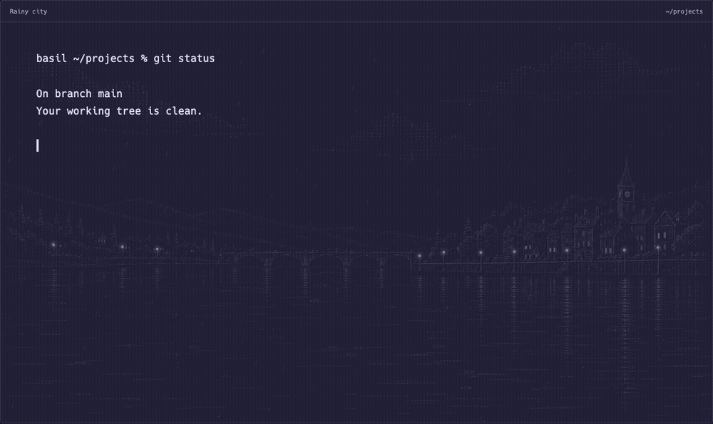
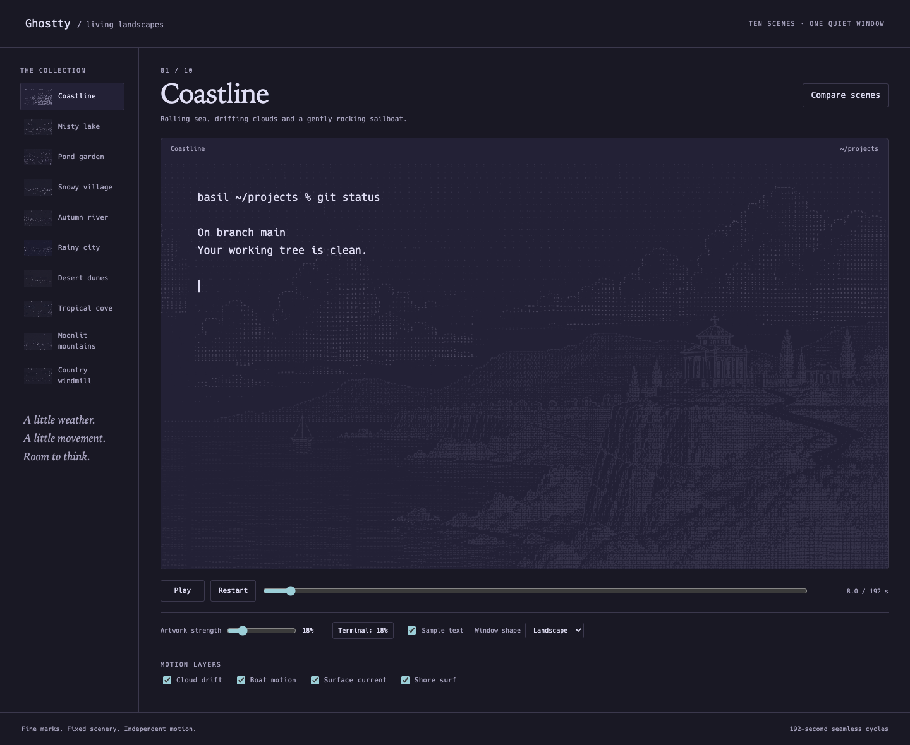
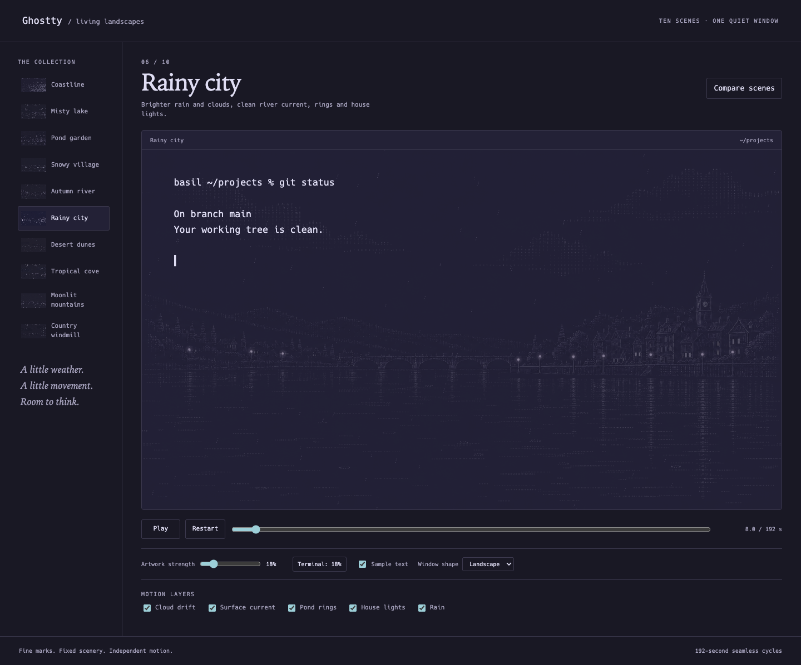

# Ghostty Landscapes

Ten quiet landscapes that move behind your terminal: rain over a riverside city, snow over a village, turning windmill sails, drifting clouds, and slow water currents.

The illustrations use tiny punctuation-like marks. They are raster artwork with an ASCII aesthetic, not a selectable text grid. Animation runs in native Ghostty shaders; buildings and reflected scenery stay anchored while independent scene layers move.





## The collection

| Scene | Motion |
| --- | --- |
| Coastline | Clouds, rocking sailboat, sea current, shoreline foam |
| Misty lake | Clouds, canoe, quiet ripples |
| Pond garden | Clouds, surface ripples, expanding rings |
| Snowy village | Sparse snowfall and staggered cottage lights |
| Autumn river | Turning leaves, floating leaves, river current |
| Rainy city | Rain, clouds, current, rings, house lights |
| Desert dunes | Windblown sand and swaying palms |
| Tropical cove | Surf, clouds, sailboat, palms, surface current |
| Moonlit mountains | Gentle lake ripples and independent star twinkling |
| Country windmill | Turning sails, clouds, a little meadow breeze |

All scenes use deterministic 192-second cycles. The gallery lets you compare two scenes, scrub time, pause, toggle motion layers, and preview landscape or narrow windows with sample terminal text.

## Build and preview

The native integration targets **macOS and Ghostty's Metal renderer**. It was tested locally with Ghostty 1.3.1 on Apple M3. The browser gallery is also usable on other platforms.

Requires Node.js 22+, Python 3.10+, and either Google Chrome or Playwright Chromium. Native checks also need Swift, glslangValidator, and spirv-cross. The picker uses fzf and chafa; image previews use Pillow.

```sh
git clone https://github.com/3-rt/ghostty-landscapes.git
cd ghostty-landscapes
npm ci
python3 -m venv .venv
source .venv/bin/activate
python3 -m pip install -r requirements.txt
npx playwright install chromium
npm run build
npm run check
open collection/index.html
```

On macOS, installed Google Chrome is used automatically. Set `GHOST_BG_BROWSER` to use another browser executable.

## Install in Ghostty

Start with an existing Ghostty config using a translucent background. This collection uses centered `cover` positioning and expects background opacity between 0 and 1. Defaults for a new config are 80% window opacity and 18% artwork strength.

```sh
brew install fzf chafa
python3 install.py
```

The installer copies the built assets, installs `ghost-bg` in `~/.local/bin`, selects animated rain, and preserves unrelated Ghostty settings. Add that bin directory to your PATH if needed. Press **Cmd+Shift+,** in Ghostty to reload.

Existing managed destinations must be ordinary files and directories. The installer rejects symlinks before changing files, so a failed install cannot overwrite their external targets. Use the directory options below for a separate installation if needed.

```sh
ghost-bg                 # interactive picker
ghost-bg use windmill    # select a scene
ghost-bg strength 18     # adjust artwork strength, then reload
ghost-bg gallery        # review all scenes in Chrome
ghost-bg off             # hide the collection, preserving unrelated shaders
```

`rain-live` remains an alias for `rain`. Every picker entry is animated. Use `install.py --help` for custom config, asset, and bin directories. `GHOSTTY_BIN` can point to a different Ghostty executable.

## How it works

1. Original illustrations and reference-guided clean plates separate fixed scenery from moving subjects. The generated image-edit prompts are recorded beside each scene.
2. Canvas preparation extracts compact coverage masks and composites edits only into the regions that own moving elements. A skyline mask keeps coastline clouds behind the island and villa.
3. The build packs coverage into 4-bit tables and generates a shader for each scene. Water samples contain surface strokes; reflected scenery stays on the fixed plate.
4. Ghostty composites these layers over its already-rendered background. The shader reads each destination pixel once, preserves alpha, and skips opaque or antialiased terminal pixels and mismatched window opacity.
5. The browser uses the same motion code and coverage values, storing packed masks in integer textures to fit WebGL's smaller constant-array limit.

Content-hashed image and shader names make Ghostty notice regenerated assets on reload. Only the selected scene is loaded by Ghostty. Animation follows the focused-terminal behavior rather than forcing every unfocused window to render continuously.

The gallery approximates the configured artwork mix; it does not simulate desktop transparency and blur. Native offscreen checks are separate from live application inspection.

## Development and checks

```sh
npm run build          # derive plates, masks, gallery, and native shaders
npm test               # syntax, all browser scenes, CLI and installer tests
brew install glslang spirv-cross
npm run check:native   # GLSL -> SPIR-V -> Metal; render every scene offscreen
```

Checks cover independent effects, fixed scenery, loop closure and nearby seam frames, landscape/portrait crops, text-pixel and alpha preservation, opacity mismatch, scene selection, strength changes, aliases, rollback, and unrelated custom shaders. GitHub Actions runs the browser, CLI, installer, and native checks on macOS.

The build renders complete scene previews and embeds the same images in the gallery and installed picker. Checks write separate evidence images and verify that installation artifacts stay unchanged.

Edit `collection/scenes.cjs` for scene geometry and timing, `collection/shader.cjs` for shared effects, and `collection/artwork.cjs` for layer preparation. Rain's original preparation lives in `shader/build-rain.cjs` and its scene folder. Build outputs and generated templates are ignored by Git; rebuild them rather than editing them.

## Artwork provenance

The coastline illustration was supplied by the author. The other scene artwork and clean plates were prepared with OpenAI's built-in image generation and reference-image editing, followed by masked compositing, layer extraction, and hand-authored animation code. Exact clean-plate prompts are in each scene's `provenance.json`.


